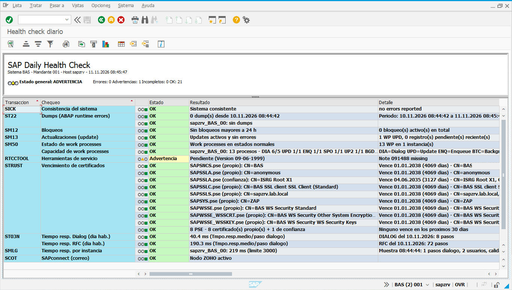
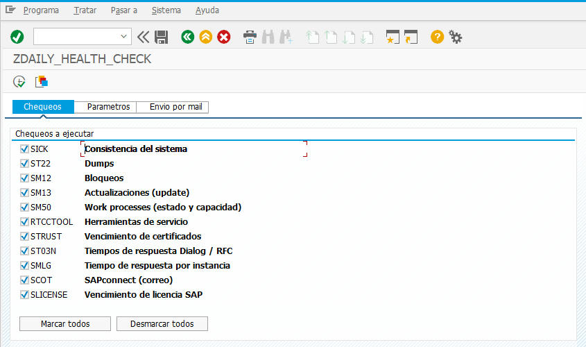
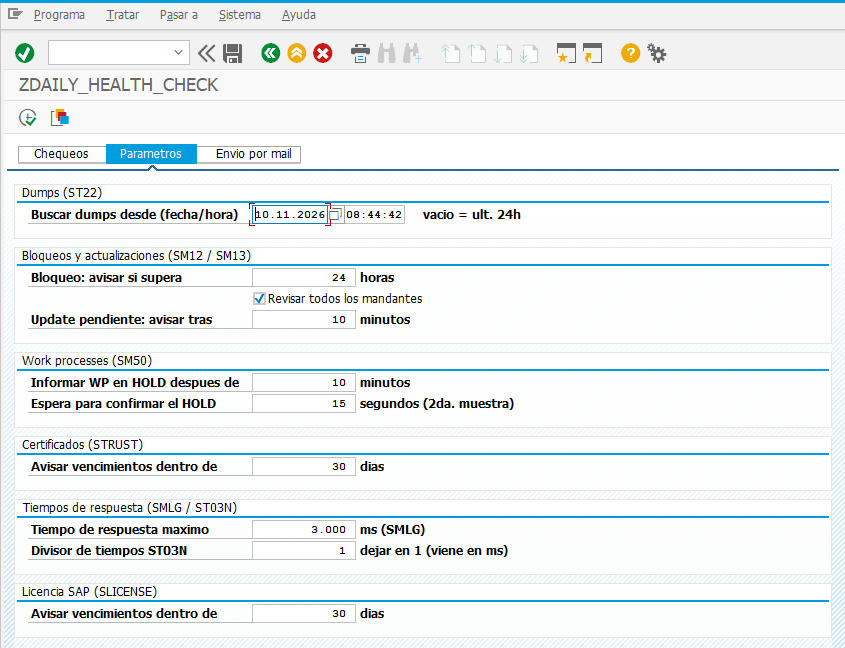
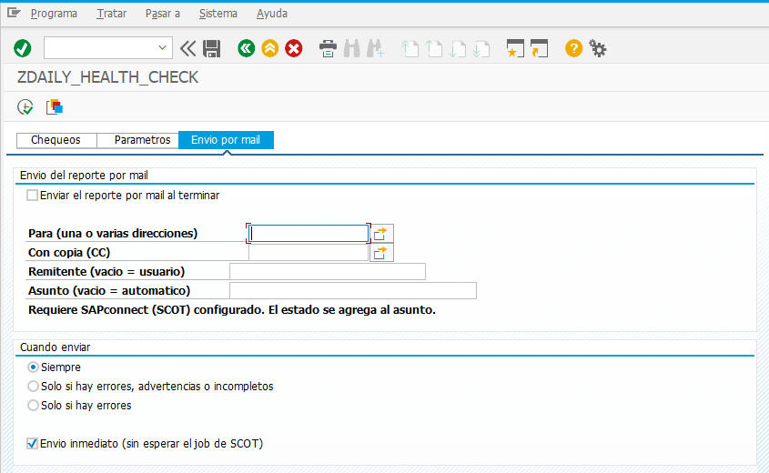
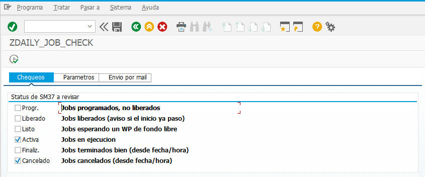
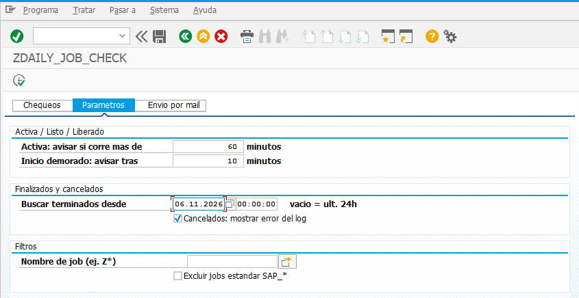
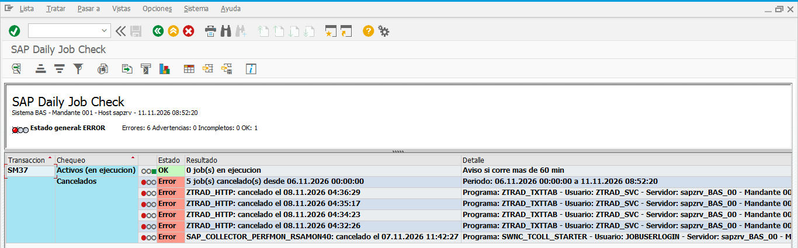
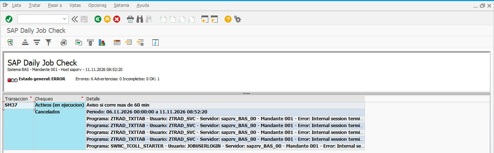

# sap-daily-health-check

Reports ABAP para el control diario de Basis de un sistema SAP, con salida en un ALV tipo tablero
(semáforo, transacción, chequeo, estado, resultado y detalle) y envío opcional por mail:

| Programa | Qué controla |
|---|---|
| [`ZDAILY_HEALTH_CHECK`](src/ZDAILY_HEALTH_CHECK.abap) | Health check general: SICK, ST22, SM12, SM13, SM50, RTCCTOOL, STRUST, ST03N, SMLG, SCOT, SLICENSE |
| [`ZDAILY_HEALTH_CHECK_V2`](src/ZDAILY_HEALTH_CHECK_V2.abap) | Versión 2 del health check (en prueba): mismos chequeos + licencias firmadas, criterio único de certificados y System PKI informativo ([cambios](#zdaily_health_check-v2--cambios)) |
| [`ZDAILY_JOB_CHECK`](src/ZDAILY_JOB_CHECK.abap) | Jobs de fondo (SM37), un chequeo por status |
| [`ZDAILY_CERT_CHECK`](src/ZDAILY_CERT_CHECK.abap) | Solo certificados (STRUST): propios, de confianza y System PKI, con el criterio de la V2 |

Cómo lee y evalúa cada dato (FMs, tablas, criterios): [ZDAILY_HEALTH_CHECK](docs/ZDAILY_HEALTH_CHECK.md) ·
[ZDAILY_HEALTH_CHECK V2](docs/ZDAILY_HEALTH_CHECK_V2.md) · [ZDAILY_JOB_CHECK](docs/ZDAILY_JOB_CHECK.md) ·
[ZDAILY_CERT_CHECK](docs/ZDAILY_CERT_CHECK.md).

Probado en SAP ECC 6.0 EHP6 (SAP_BASIS 731, kernel 722, Sybase ASE). Las llamadas a FMs y tablas
que pueden cambiar entre releases se hacen en forma dinámica: si algo no existe o tiene otra interfaz,
el chequeo queda **INCOMPLETO** con el motivo, en lugar de dar dump.

> Capturas reales del sistema de laboratorio BAS/001 (host `sapzrv`).

## ZDAILY_HEALTH_CHECK – chequeos

| Transacción | Chequeo | Criterio |
|---|---|---|
| SICK | Consistencia del sistema | OK si informa "no errors reported" |
| ST22 | Dumps | Cantidad por instancia desde fecha/hora configurable (por defecto, últimas 24 h), con desglose por error |
| SM12 | Bloqueos | Detalla todos; **Error** si alguno supera N horas (por defecto 24) |
| SM13 | Actualizaciones | WP de update presentes, sin registros con error ni pendientes viejos |
| SM50 | Work processes | Stopped/Ended = Error; HOLD solo si supera N minutos y sigue sin cambios en una 2da muestra. Además, total/libres por tipo de WP |
| RTCCTOOL | Herramientas de servicio | Recomendaciones / notas pendientes |
| STRUST | Certificados | CN y vencimiento de los certificados propios y de confianza de cada PSE; aviso N días antes |
| ST03N | Tiempos de respuesta | Tiempo resp. medio / paso de diálogo (ms) de Dialog y RFC del día hábil anterior (retrocede hasta el último con datos) |
| SMLG | Tiempo por instancia | Valor en vivo del message server (igual que SMLG) contra un límite (por defecto 3000 ms) |
| SCOT | SAPconnect | Nodos activos o, si no hay nodos, cola vacía; job RSCONN01 liberado |
| SLICENSE | Licencia SAP | Vencimiento de la licencia activa (misma lógica que SLICENSE) |
| SOST | Envío por mail | Resultado del envío del reporte (opcional) |

## ZDAILY_HEALTH_CHECK V2 – cambios

[`src/ZDAILY_HEALTH_CHECK_V2.abap`](src/ZDAILY_HEALTH_CHECK_V2.abap) es la versión 2 del health check.
Tiene los mismos chequeos, pantalla y envío por mail que la versión actual, con estos cambios
(detalle técnico y pruebas en [docs/ZDAILY_HEALTH_CHECK_V2.md](docs/ZDAILY_HEALTH_CHECK_V2.md)):

| Transacción | Chequeo | Cambio en la V2 |
|---|---|---|
| STRUST | Certificados | Mismo criterio para certificados **propios y de confianza**: vencido = **Error**, por vencer dentro de N días = **Advertencia**. Antes un certificado de confianza vencido daba solo Advertencia. La fila de resumen dice "N vencido(s), M por vencer en X dias". |
| STRUST | Certificados | Los PSE de **System PKI** (`sap_system_pki*`, gestionados por el kernel y protegidos con PIN) no se leen: salen como fila informativa **OK** ("PSE de System PKI, gestionado por el kernel"). Antes quedaban **Incompleto**. |
| SLICENSE | **Licencias firmadas** (nuevo) | La v1 solo revisa las licencias **antiguas** (formato clásico, atado a la clave de hardware). La V2 suma las licencias **firmadas** (formato nuevo, una por producto, las de la pantalla principal de SLICENSE) en un ítem aparte con su propia tilde. Ver abajo. |
| SLICENSE | Licencias antiguas | El chequeo de licencia de la v1, sin cambios de lógica; solo cambia el nombre a *Licencias antiguas*. |
| – | Encabezado | Los contadores (Errores, Advertencias, Incompletos, OK) ya no suman las filas de resumen de cada chequeo, así que cada problema se cuenta una vez. |
| RTCCTOOL | Herramientas de servicio | Ya no ejecuta RTCCTOOL: lee el resultado de la última corrida que ST-A/PI guarda en `/SSF/BTAB` (sin popups ni corridas nuevas). Avisa si esa corrida tiene más de N días o si RTCCTOOL usa recomendaciones sin actualizar desde SAP (corrió sin conexión). |

### Licencias firmadas (nuevo en la V2)

Revisa las licencias nuevas (firmadas) del SID con `SLIC_LIKEY_GET_ALL_LICENSES`, el mismo origen que la
pantalla de licencias firmadas de SLICENSE:

- **Por licencia**, según su validez: SID incorrecto, temporal no permitida, vencida o firma no válida = **Error**;
  validez desconocida o todavía no válida = **Advertencia**. Si es válida, se mira el vencimiento:
  permanente (31.12.9999) = OK, vencida = **Error**, vence dentro de N días = **Advertencia**
  (mismo parámetro *Avisar vencimientos dentro de* que las licencias antiguas).
- **Producto estándar** (por ejemplo `NetWeaver_SYB`): se verifica con `SLIC_LIKEY_CHECK`; si no hay
  licencia válida, **Error**.
- **Certificado de mantenimiento** (`Maintenance_<base de datos>`): si está instalado se evalúa como
  cualquier licencia; si no está instalado sale como fila **informativa OK**.
- Fila de resumen "N licencia(s) firmada(s) para SID" con el peor estado, y debajo una fila por licencia.
  No muestra la clave de hardware ni el número de instalación.

### Pendiente para cerrar la V2

- Nombre final del programa (hoy `REPORT zdaily_health_check`, en el sistema se prueba como `ZDAILY_HEALTH_CHECK_V2`).
  Cuando la V2 quede como definitiva, su doc reemplaza a [docs/ZDAILY_HEALTH_CHECK.md](docs/ZDAILY_HEALTH_CHECK.md).

## Instalación

1. SE38 → crear `ZDAILY_HEALTH_CHECK` (tipo *Programa ejecutable*).
2. Pegar el contenido de [`src/ZDAILY_HEALTH_CHECK.abap`](src/ZDAILY_HEALTH_CHECK.abap) y activar.
   No hace falta crear elementos de texto: los textos de pantalla se cargan desde el código.

Para probar la V2 sin tocar la versión actual, crear `ZDAILY_HEALTH_CHECK_V2` y pegar
[`src/ZDAILY_HEALTH_CHECK_V2.abap`](src/ZDAILY_HEALTH_CHECK_V2.abap) (la sentencia `REPORT` interna no
tiene que coincidir con el nombre del programa).

Si al activar aparece `GEN_SELECTION_SCREEN_ERROR`, ejecutar el programa `RSDBGENA` sobre
`ZDAILY_HEALTH_CHECK` para ver el detalle (por ejemplo, *Screen contains overlapping objects*).

## Uso

La pantalla de selección tiene pestañas:

- **Chequeos**: qué controles ejecutar (botones *Marcar todos* / *Desmarcar todos*).
- **Parámetros**: umbrales de cada control (horas de bloqueo, minutos de HOLD, días de aviso, etc.).
- **Envio por mail**: envía el reporte al terminar (ver abajo).

| Chequeos | Parámetros |
|---|---|
|  |  |

El resultado es un ALV agrupado por transacción, con semáforo, estado coloreado y un encabezado
con el estado general y el conteo de errores, advertencias, incompletos y OK (ver la captura de arriba).

### Envío por mail

Con la tilde *Enviar el reporte por mail* el programa manda el resultado con `CL_BCS`.
El cuerpo del mail es la misma tabla del ALV en HTML (estado general arriba, celda de estado
coloreada), así que se lee directo en el cliente de correo, sin adjuntos.

- **Para / CC**: una o varias direcciones.
- **Remitente**: opcional (si se deja vacío, el del usuario en SU01). Con proveedores SMTP
  como Brevo tiene que ser un remitente verificado.
- **Asunto**: opcional; si se deja vacío se arma solo. En ambos casos se agrega el estado general.
- **Cuándo enviar**: siempre, solo si hay errores/advertencias/incompletos, o solo si hay errores.
- **Envío inmediato**: si no se marca, el mail queda en cola hasta el próximo job de SCOT.

Requiere SAPconnect configurado (SCOT, nodo SMTP). El resultado del envío aparece como
última fila del reporte (*SOST – Envío del reporte por mail*); el estado real de salida se ve en SOST.

### Variantes y jobs

Una variante guarda todas las pestañas (Chequeos, Parámetros y Envio por mail), pero
**SAP solo incluye las pestañas que se abrieron antes de grabarla**: hacer clic en cada pestaña y recién después *Grabar como variante*.

Para jobs de fondo, en la variante conviene poner `P_DMPDT` (dumps desde) como
variable de selección **D** → *Fecha actual +/- ??? días* = `-1`.

En fondo, el ALV sale al spool del job y el estado general queda en el log del job.

## ZDAILY_JOB_CHECK – jobs de fondo (SM37)

Misma estructura que el health check (pestañas *Chequeos* / *Parametros* / *Envio por mail*,
ALV tipo tablero y mail en HTML). Un chequeo por cada status de SM37; por defecto se ejecutan
**Activa** y **Cancelado**.

| Status SM37 | `TBTCO-STATUS` | Período | Criterio |
|---|---|---|---|
| Progr. | P | estado actual | Informativo (programados sin liberar) |
| Liberado | S | estado actual | **Advertencia** si su inicio previsto pasó hace más de N min y no arrancó |
| Listo | Y | estado actual | **Advertencia** si espera un WP de fondo hace más de N min (por defecto 10) |
| Activa | R | estado actual | **Advertencia** si corre hace más de N min (por defecto 60) |
| Finaliz. | F | desde fecha/hora | Informativo, con la duración de cada job |
| Cancelado | A | desde fecha/hora | **Error**, con el último mensaje de error del log del job (sin la línea genérica *Job cancelled*) |

- Fecha/hora *desde* para finalizados y cancelados: por defecto, últimas 24 h (F4 con calendario).
- Filtros: nombre de job (admite patrones como `Z*`) y opción para excluir los jobs estándar `SAP_*`.
- Máximo 200 jobs por status; el resumen indica si hay más.
- Si corre como job de fondo, no se lista a sí mismo.

| Chequeos | Parámetros |
|---|---|
|  |  |

### Ejemplo: jobs cancelados

Ejecución con los valores por defecto (*Activa* y *Cancelado*) buscando desde el **06.11.2026 00:00:00**.
No hay jobs en ejecución y aparecen 5 cancelados, cada uno con su fecha/hora:

En la columna *Detalle* figuran programa, usuario, servidor, mandante y el error tomado del log
del job (en este caso `STRING_LENGTH_TOO_LARGE` y `EXPORT_TABLE_UPDATE_CONFLICT`, ver ST22).
En pantalla se corta a 128 caracteres (ver *Limitaciones conocidas*); en el mail sale completo.

## Limitaciones conocidas

- El ALV grid muestra como máximo **128 caracteres por celda**: los detalles más largos se ven
  cortados en pantalla, pero el contenido está completo y el **mail lo muestra entero**.
- Jobs en *Listo* que quedaron así tras una caída del sistema (huérfanos) aparecen uno por uno.
  Se limpian desde SM37 (*Job → Verificar status*) o SM65.
