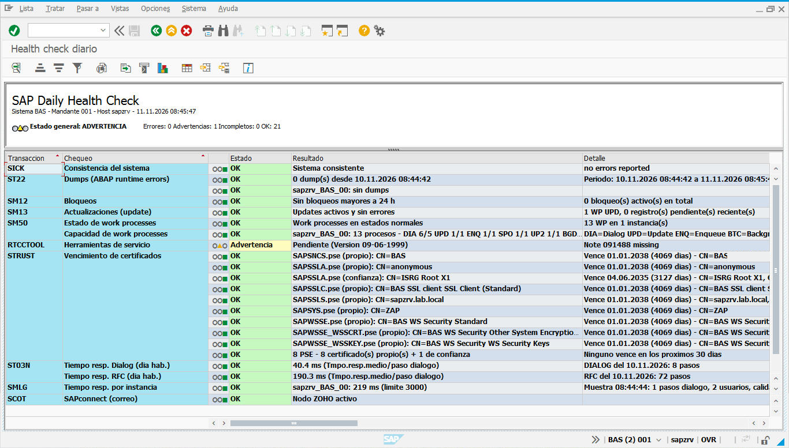
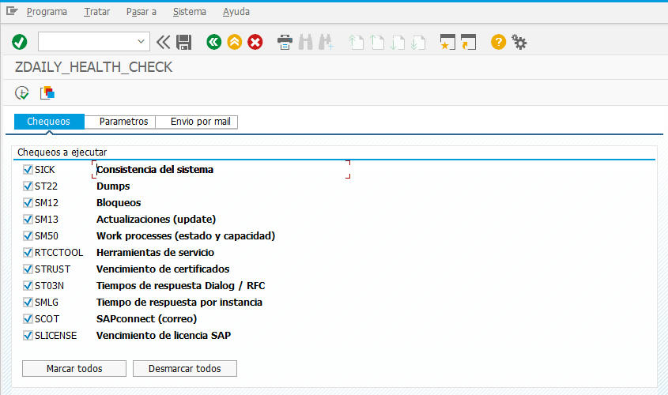
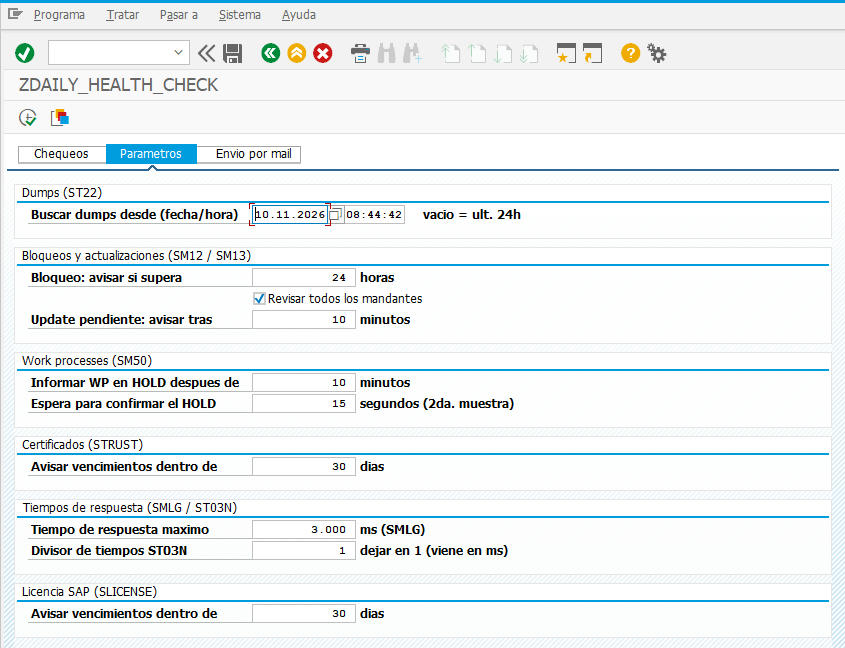
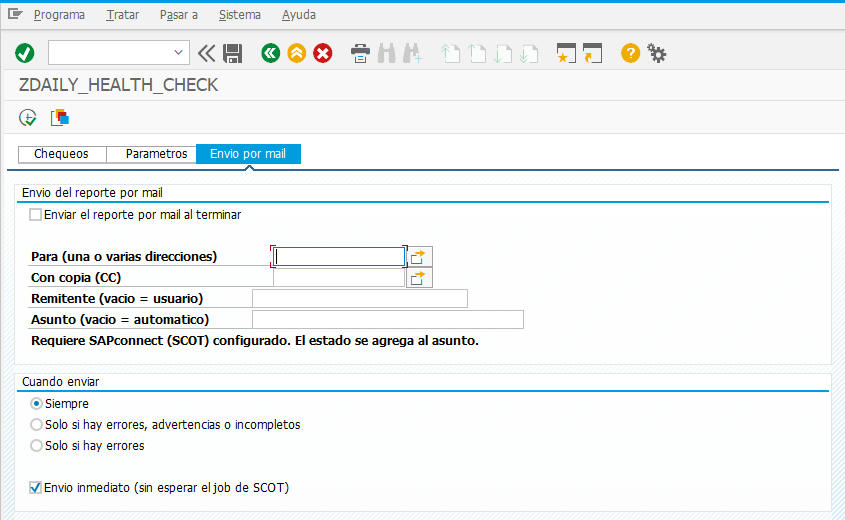
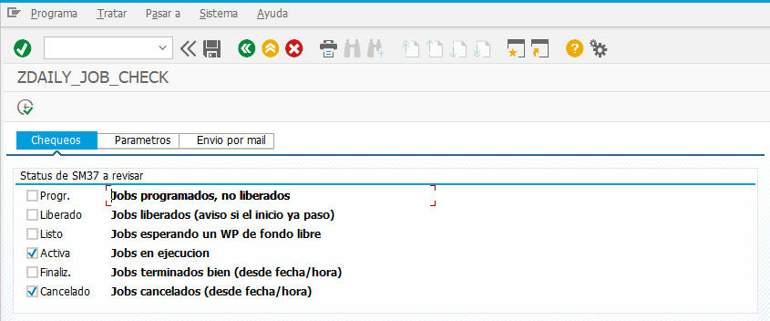
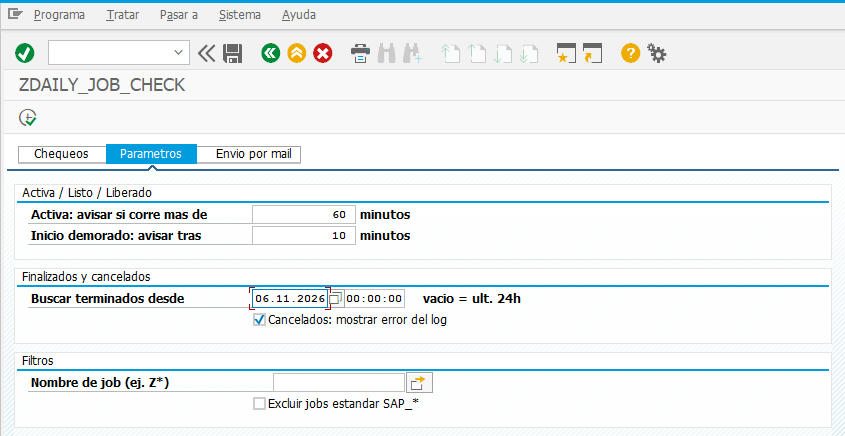
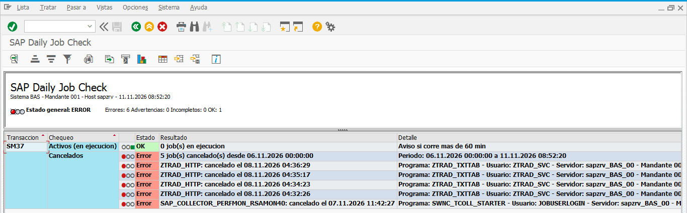
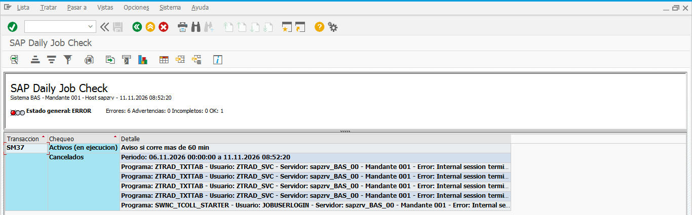

# sap-daily-health-check

Reports ABAP para el control diario de Basis de un sistema SAP, con salida en un ALV tipo tablero
(semáforo, transacción, chequeo, estado, resultado y detalle) y envío opcional por mail:

| Programa | Qué controla |
|---|---|
| [`ZDAILY_HEALTH_CHECK`](src/ZDAILY_HEALTH_CHECK.abap) | Health check general: SICK, ST22, SM12, SM13, SM50, RTCCTOOL, STRUST, ST03N, SMLG, SCOT, SLICENSE |
| [`ZDAILY_JOB_CHECK`](src/ZDAILY_JOB_CHECK.abap) | Jobs de fondo (SM37), un chequeo por status |

Probado en SAP ECC 6.0 EHP6 (SAP_BASIS 731, kernel 722, Sybase ASE). Las llamadas a FMs y tablas
que pueden cambiar entre releases se hacen en forma dinámica: si algo no existe o tiene otra interfaz,
el chequeo queda **INCOMPLETO** con el motivo, en lugar de dar dump.

> Capturas reales del sistema de laboratorio BAS/001 (host `sapzrv`).

## ZDAILY_HEALTH_CHECK – chequeos

| Transacción | Chequeo | Criterio |
|---|---|---|
| SICK | Consistencia del sistema | OK si informa "no errors reported" |
| ST22 | Dumps | Cantidad por instancia desde fecha/hora configurable (por defecto, últimas 24 h), con desglose por error |
| SM12 | Bloqueos | Detalla todos; **Error** si alguno supera N horas (por defecto 24) |
| SM13 | Actualizaciones | WP de update presentes, sin registros con error ni pendientes viejos |
| SM50 | Work processes | Stopped/Ended = Error; HOLD solo si supera N minutos y sigue sin cambios en una 2da muestra. Además, total/libres por tipo de WP |
| RTCCTOOL | Herramientas de servicio | Recomendaciones / notas pendientes |
| STRUST | Certificados | CN y vencimiento de los certificados propios y de confianza de cada PSE; aviso N días antes |
| ST03N | Tiempos de respuesta | Tiempo resp. medio / paso de diálogo (ms) de Dialog y RFC del día hábil anterior (retrocede hasta el último con datos) |
| SMLG | Tiempo por instancia | Valor en vivo del message server (igual que SMLG) contra un límite (por defecto 3000 ms) |
| SCOT | SAPconnect | Nodos activos o, si no hay nodos, cola vacía; job RSCONN01 liberado |
| SLICENSE | Licencia SAP | Vencimiento de la licencia activa (misma lógica que SLICENSE) |
| SOST | Envío por mail | Resultado del envío del reporte (opcional) |

## Instalación

1. SE38 → crear `ZDAILY_HEALTH_CHECK` (tipo *Programa ejecutable*).
2. Pegar el contenido de [`src/ZDAILY_HEALTH_CHECK.abap`](src/ZDAILY_HEALTH_CHECK.abap) y activar.
   No hace falta crear elementos de texto: los textos de pantalla se cargan desde el código.

Si al activar aparece `GEN_SELECTION_SCREEN_ERROR`, ejecutar el programa `RSDBGENA` sobre
`ZDAILY_HEALTH_CHECK` para ver el detalle (por ejemplo, *Screen contains overlapping objects*).

## Uso

La pantalla de selección tiene pestañas:

- **Chequeos**: qué controles ejecutar (botones *Marcar todos* / *Desmarcar todos*).
- **Parámetros**: umbrales de cada control (horas de bloqueo, minutos de HOLD, días de aviso, etc.).
- **Envio por mail**: envía el reporte al terminar (ver abajo).

| Chequeos | Parámetros |
|---|---|
|  |  |

El resultado es un ALV agrupado por transacción, con semáforo, estado coloreado y un encabezado
con el estado general y el conteo de errores, advertencias, incompletos y OK (ver la captura de arriba).

### Envío por mail

Con la tilde *Enviar el reporte por mail* el programa manda el resultado con `CL_BCS`.
El cuerpo del mail es la misma tabla del ALV en HTML (estado general arriba, celda de estado
coloreada), así que se lee directo en el cliente de correo, sin adjuntos.

- **Para / CC**: una o varias direcciones.
- **Remitente**: opcional (si se deja vacío, el del usuario en SU01). Con proveedores SMTP
  como Brevo tiene que ser un remitente verificado.
- **Asunto**: opcional; si se deja vacío se arma solo. En ambos casos se agrega el estado general.
- **Cuándo enviar**: siempre, solo si hay errores/advertencias/incompletos, o solo si hay errores.
- **Envío inmediato**: si no se marca, el mail queda en cola hasta el próximo job de SCOT.

Requiere SAPconnect configurado (SCOT, nodo SMTP). El resultado del envío aparece como
última fila del reporte (*SOST – Envío del reporte por mail*); el estado real de salida se ve en SOST.

### Variantes y jobs

Una variante guarda todas las pestañas (Chequeos, Parámetros y Envio por mail), pero
**SAP solo incluye las pestañas que se abrieron antes de grabarla**: hacer clic en cada pestaña y recién después *Grabar como variante*.

Para jobs de fondo, en la variante conviene poner `P_DMPDT` (dumps desde) como
variable de selección **D** → *Fecha actual +/- ??? días* = `-1`.

En fondo, el ALV sale al spool del job y el estado general queda en el log del job.

## ZDAILY_JOB_CHECK – jobs de fondo (SM37)

Misma estructura que el health check (pestañas *Chequeos* / *Parametros* / *Envio por mail*,
ALV tipo tablero y mail en HTML). Un chequeo por cada status de SM37; por defecto se ejecutan
**Activa** y **Cancelado**.

| Status SM37 | `TBTCO-STATUS` | Período | Criterio |
|---|---|---|---|
| Progr. | P | estado actual | Informativo (programados sin liberar) |
| Liberado | S | estado actual | **Advertencia** si su inicio previsto pasó hace más de N min y no arrancó |
| Listo | Y | estado actual | **Advertencia** si espera un WP de fondo hace más de N min (por defecto 10) |
| Activa | R | estado actual | **Advertencia** si corre hace más de N min (por defecto 60) |
| Finaliz. | F | desde fecha/hora | Informativo, con la duración de cada job |
| Cancelado | A | desde fecha/hora | **Error**, con el último mensaje de error del log del job (sin la línea genérica *Job cancelled*) |

- Fecha/hora *desde* para finalizados y cancelados: por defecto, últimas 24 h (F4 con calendario).
- Filtros: nombre de job (admite patrones como `Z*`) y opción para excluir los jobs estándar `SAP_*`.
- Máximo 200 jobs por status; el resumen indica si hay más.
- Si corre como job de fondo, no se lista a sí mismo.

| Chequeos | Parámetros |
|---|---|
|  |  |

### Ejemplo: jobs cancelados

Ejecución con los valores por defecto (*Activa* y *Cancelado*) buscando desde el **06.11.2026 00:00:00**.
No hay jobs en ejecución y aparecen 5 cancelados, cada uno con su fecha/hora:

En la columna *Detalle* figuran programa, usuario, servidor, mandante y el error tomado del log
del job (en este caso `STRING_LENGTH_TOO_LARGE` y `EXPORT_TABLE_UPDATE_CONFLICT`, ver ST22).
En pantalla se corta a 128 caracteres (ver *Limitaciones conocidas*); en el mail sale completo.

## Limitaciones conocidas

- El ALV grid muestra como máximo **128 caracteres por celda**: los detalles más largos se ven
  cortados en pantalla, pero el contenido está completo y el **mail lo muestra entero**.
- Jobs en *Listo* que quedaron así tras una caída del sistema (huérfanos) aparecen uno por uno.
  Se limpian desde SM37 (*Job → Verificar status*) o SM65.
